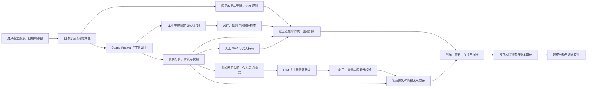

# Finrobot_MFM5110FinalProject_V2

面向 MFM5110 小组项目的 A 股投研与量化实验工具。V2 在组员 1 的 V1 上，补齐了交互式 SMA 回测、代码生成与风险检查，并新增独立的 LLM 因子构思、样本外回放和多案例生成稳定性实验，供组员使用和继续开发。

**版本：V2；说明更新：2026-11-19。** `run_finrobot.cmd` 默认自动分派，也可指定六个角色之一；新增本地 SQLite 研究记忆，支持恢复会话、显式笔记与历史查询。聊天支持参数化 SMA、确定性因子与受限 JSON 规则回测；表达式因子样本外实验和生成稳定性实验仍使用独立批量入口。

使用时，你先用自然语言指定股票、日期、均线和资金；程序获取或读取真实行情，运行回测并比较买入持有。你可以继续要求生成同规则 Python 代码、执行代码和检查风险，最后查看分析、交易记录与图表。原有的基本面、市场分析和研究报告角色也保留，具体可用范围见下文。

- [V2 仓库与下载](https://github.com/ohayoo335/Finrobot_MFM5110FinalProject_V2)：使用 Code → Download ZIP，或 `git clone https://github.com/ohayoo335/Finrobot_MFM5110FinalProject_V2.git`。
- [V1 与 V2 对照](#v2-相较-v1-补充了什么) · [当前完整功能](#当前完整功能) · [首次运行六步](#快速开始) · [交互示例](#第-5-步开始对话) · [本地 Memory](#本地研究记忆memory) · [实验复现](#实验与复现) · [功能边界](#当前边界与未完成项)。
- 开发交接：[项目状态](PROJECT_STATUS.md)、[补全计划](COMPLETION_PLAN.md)、[环境状态](ENVIRONMENT_STATUS.md)。本仓库提供代码、数据与实验记录，课程报告正文尚未编写。

已有项目环境和本地模型 Key 时，在仓库根目录运行：

```powershell
.\run_finrobot.cmd --role Quant_Analyst
```

## V2 相较 V1 补充了什么

V1 来源为[组员 1 分享的项目](https://github.com/yjt2003/Finrobot_MFM5110FinalProject)，本次对照基线为本仓库保留的提交 [`8d2cc02`](https://github.com/ohayoo335/Finrobot_MFM5110FinalProject_V2/commit/8d2cc02dde93053b0a4faeec9efd19ec618ff75a)。以下按该基线与当前 V2 代码比较；V1 上游之后的改动不包含在这个对照中。

| 方面 | V1 已有内容 | V2 的补充或改动 |
| --- | --- | --- |
| 投研角色 | `A_Share_Analyst`、`Market_Analyst`、`Expert_Investor`，以及 AutoGen 角色与工具注册框架 | 保留原角色，新增量化、因子计算、因子构思三个角色；支持自动分派，参数化 SMA、固定动量和自定义 JSON 规则分别使用对应工具 |
| A 股数据 | `CNStockUtils`、AkShare / Tushare 路由及行情回退接口 | 修复腾讯行情字段与特定 AkShare 版本的成交量口径；新增 OHLCV 清洗、来源与单位记录、真实数据快照及 SHA-256 校验 |
| 回测 | `BackTraderUtils.back_test`，默认使用 Yahoo 行情，支持策略、初始资金、Sizer 等参数 | 增加本地 CSV 入口；新增统一的 A 股信号回测流程，让人工 SMA、买入持有与 LLM SMA 使用同一份数据、费用和执行引擎 |
| LLM 代码生成与因子构思 | 通用 Agent、编程与执行基础模块 | 新增固定 SMA 代码生成、AST 与因果性检查、限时子进程执行和修正记录；另提供受限 DSL 因子构思及冻结后的样本外回放 |
| 风险约束 | 原有角色中的风险分析要求，以及基础回测参数 | 在新回测流程落实只做多、整手、资金与开仓预算约束、佣金及滑点；新增独立账本审计和 `check_quant_risk` 工具 |
| 多轮交互 | 已支持单次提问与保留上下文的 CLI 对话 | 接入用户指定股票、日期、均线、资金和开仓预算；支持继续生成代码、查询风险及切换实验，实验按参数和数据哈希隔离 |
| 实验与证据 | 保留的投资小组、多因子、组合优化等原有实验脚本 | 原固定案例 5 次生成与 45 次冻结回放；新增 15 次多案例独立生成、12 个因子想法与去重后 27 个样本外比较，保存失败、指标、交易和图表 |
| 终端输出 | Agent 调用过程直接显示在控制台 | 默认显示等待提示、本轮最终分析和保存位置；详细过程进入日志，支持 `--verbose`；修复最终答复漏显及误取历史文本的问题 |
| 环境与交接 | 原有依赖表、配置说明和示例 | 新增 Windows / Python 3.11 锁定依赖、根目录启动脚本、完整离线复验、162 项测试、会话与完整 JSON 规则恢复、打包脚本及不含真实 Key 的配置模板 |

V2 将已有投研框架扩展为可交互、可复现、可核对的量化实验：既检查固定规则代码的实现，也评价模型提出的受限因子。现有结果尚未证明 LLM 能提高投资收益。

## 当前完整功能

### 1. 主要角色与原有扩展模块

统一入口为 `run_finrobot.cmd`，默认按问题自动分派角色；用 `--mode single --role`（或只给 `--role`）固定单角色。省略问题进入多轮对话，提供问题则执行单次分析。

| 角色 | 当前代码提供的能力 | 验证范围 |
| --- | --- | --- |
| `A_Share_Analyst`（单角色默认） | 查询公司资料、行情、分红、三大财务报表、财务指标、同业比较、历史估值、机构预期、研报、公告与新闻，并调用价格图表工具 | 沿用 V1；已验证初始化和基础模型工作流，完整基本面分析未逐项验收 |
| `Market_Analyst` | 结合区间行情、公司与市场新闻、热度排名、公告及公司背景解释市场表现 | 沿用 V1；已验证初始化，全部数据接口与完整分析流程未逐项验收 |
| `Expert_Investor` | 查询年报链接、财务与机构数据，调用 K 线、股价表现、PE/EPS 图表及 PDF 研究报告工具 | 沿用 V1；已验证初始化，完整 PDF 报告流程尚未验收 |
| `Quant_Analyst` | 按用户参数准备真实数据，比较 SMA 与买入持有，生成并执行同规则 Python 代码，独立检查风险，解释实际回测结果 | V2 新增；已完成真实三轮对话、工具调用与回测数字核对 |
| `A_Share_Factor_Researcher` | 用确定性工具计算 20/60 日动量、20 日年化波动率与 20 日均量；按固定动量规则回测，并与买入持有、沪深 300 比较 | 因子计算与分项汇总已通过本轮真实验收；固定动量工具另有离线回归 |
| `A_Share_Factor_Ideator` | 提出可检验的因子或规则候选，用受限 JSON DSL 回测（动量、均量比、均线交叉），结果走 V2 成本模型与账本审计 | 已通过真实规则构思、跨轮回测、换股及独立数值/账本核对 |

仓库还保留 V1 的通用编程、数据分析等角色，单 Agent、RAG、Shadow 与多 Agent 工作流，FinNLP 数据源、文本/PDF/RAG 工具，以及投资小组、多因子、组合优化等脚本。这些模块可供后续开发，未全部纳入 V2 量化验收；新增量化主流程使用 `SingleAssistant` 与工具调用。

### 2. 真实数据获取、清洗与复用

- A 股数据通过 `CNStockUtils` 获取，可配置 `auto`、`akshare`、`tushare`。`auto` 对支持的接口优先尝试 Tushare，失败后回退 AkShare；新闻、公告及部分财务接口仍走 AkShare。随仓库的配置模板选择 `akshare`，无需 Tushare Token。
- 量化流程统一日期和 OHLCV 字段，排序、去重、去除不完整观测，检查价格与成交量，记录成交量从“手”到“股”的转换；不补造缺失交易日或模拟行情。
- 保存适配器输出、清洗 CSV、实际覆盖日期、来源、复权方式、处理记录和哈希。交互中仅复用标的、复权、覆盖范围、历史预热与哈希均符合要求的数据，否则调用数据层获取真实行情。
- 固定实验、跨标的实验、个人交互实验分别存放；多标的与交互实验按参数及数据哈希区分结果目录，原始固定案例另行保留。

### 3. 策略回测、绩效与独立风险检查

当前已验证的规则是：**收盘 SMA(fast) > SMA(slow) 时目标为持有，否则空仓**，并与买入持有比较。两者使用同一数据和资金费用假设。

- 只做多、持有或空仓；收盘形成的信号最早在下一个有行情的交易日开盘执行。
- 默认初始资金 100,000 元，开仓预算 80%，100 股一手，佣金率 0.03%，最低佣金 5 元，滑点 0.05%；这是实验配置中的简化假设。
- 交互可修改股票、日期、fast/slow、初始资金与开仓预算；费用、整手等参数由实验配置控制。多标的验证另支持自定义配置文件。
- 输出初始/最终资产、总收益率、年化收益率、最大回撤、Sharpe、成交订单数、累计佣金、最低现金，以及每日净值、交易记录、风险事件和对比图。
- `check_quant_risk` 根据成交记录独立重建现金和持股，核对净值、指标、信号与成交先后、整手、资金及开仓预算，并报告实际持仓权重。

`max_position` 是**每次开仓的预算比例**，并非持续硬性仓位上限。持仓后权重会随价格漂移，风险工具会明确报告这一点。多标的及交互实验使用过去数据预热，预热期不交易、不计绩效，第一评价日收盘才形成首个可执行信号。

### 4. LLM 生成代码、校验、运行与修正

Quant_Analyst 或批量实验可让模型生成两个函数：`generate_signals(data, fast, slow)` 与 `run_strategy(data, config)`。生成代码须通过语法白名单、接口检查、固定 SMA 信号一致性、前缀因果性及可信回测引擎结果一致性检查。

执行使用有限时的独立 Python 进程。源码、原始响应、执行结果和错误会保存；交互工具把失败原因返回模型供其修正，批量实验也保留初次失败与后续修正记录。模型生成的是该固定规则的 Python 实现，回测仍由统一引擎完成。

AST 限制和进程超时用于约束此任务，不等同于通用操作系统沙箱。聊天中的代码生成仍限于固定 SMA；独立因子实验支持受限表达式构思，使用方法见后文。任意 Python 策略生成、自动择优或参数寻优尚未实现。

新增 `A_Share_Factor_Ideator` 可以在聊天中提出受限 JSON 规则并调用确定性回测；它生成的是规则数据，沿用相同费用与账本审计，不执行模型提供的任意 Python。该入口与独立表达式 DSL 实验分别记录。

### 5. 可核对的工具调用与结果文件

| Quant_Analyst 工具 | 功能 |
| --- | --- |
| `get_data_summary` | 读取固定 V2 案例的数据摘要与快照哈希 |
| `backtest_reference` | 对固定案例运行人工 SMA 或买入持有 |
| `read_backtest_result` | 读取固定案例已保存的指标与交易结果 |
| `prepare_quant_experiment` | 按用户指定参数准备实验，返回独立 `experiment_id` |
| `compare_quant_strategies` | 对该交互实验运行 SMA / 买入持有并保存指标、净值、交易与图表 |
| `execute_quant_code` | 保存并校验当轮模型代码，执行后回传结果或错误 |
| `check_quant_risk` | 独立审计人工或生成策略，保存风险检查结果 |

用户指定的股票与参数走后四个工具；前三个工具用于已有的固定案例。结果数字来自 Python 工具与保存文件，代码校验会核对生成实现与人工规则。

## 快速开始

第一次使用按下面六步操作；已经装好环境并填好 Key 的组员可直接从[第 5 步](#第-5-步开始对话)开始。命令均在项目根目录的 PowerShell 中运行。

### 第 1 步：下载并进入项目目录

若已从 GitHub 下载 ZIP，先解压，再在解压后的项目文件夹中打开 PowerShell。若使用 Git，运行：

```powershell
git clone https://github.com/ohayoo335/Finrobot_MFM5110FinalProject_V2.git
cd Finrobot_MFM5110FinalProject_V2
```

**这一步完成后：** 当前目录应能同时看到 `README.md`、`setup.py` 和 `run_finrobot.cmd`。ZIP 解压后的文件夹名称可能不同，以里面的文件为准。

### 第 2 步：创建 Python 3.11 环境并安装依赖

已验证环境为 **Windows x64、Python 3.11.16、CPU**，无需独立显卡。先确保本机已安装 Python 3.11，再依次运行：

```powershell
py -3.11 --version
py -3.11 -m venv .venv
.\.venv\Scripts\python.exe -m pip install -r requirements-windows-py311.lock.txt
.\.venv\Scripts\python.exe -m pip install --no-deps --no-build-isolation -e .
.\.venv\Scripts\python.exe -c "import nltk; nltk.download('punkt', download_dir='.cache/nltk_data'); nltk.download('averaged_perceptron_tagger', download_dir='.cache/nltk_data')"
.\.venv\Scripts\python.exe -m pip check
```

**这一步完成后：** 根目录出现 `.venv`，最后一行检查应返回 `No broken requirements found.`。安装依赖和下载 NLTK 数据需要联网；首次安装包含较大的 PDF/RAG 依赖，耗时取决于网络。尚未安装 Python 3.11 时，先完成 Python 安装再执行命令。

项目要求 Python 3.10–3.11，推荐使用上述已验证的 3.11；Python 3.13 不适用。其他系统、依赖版本和可选 uv 安装方式见[环境补充](#环境补充)。

### 第 3 步：先验证本地流程

仓库已包含实验所需的真实数据快照与模型代码。先运行下面的完整离线检查，确认环境、回测和代码执行能正常工作：

```powershell
.\.venv\Scripts\python.exe scripts/validate_v2.py
```

**这一步完成后：** 控制台 9 项检查的 `ok` 应全部为 `true`，汇总写入 `artifacts/quant_v2/validation_summary.json`。检查覆盖 162 项测试、依赖、交互工具、原 5 份代码、多标的评价、15 份稳定性代码重跑、因子回放与指标汇总；新增测试覆盖 Memory、完整规则恢复、旧数据库升级、嵌套预热、历史财务和 CLI 工具。首次安装不计入复验耗时；该离线命令不自动发起新的模型对话。

这一检查以仓库内保存的实验记录完整为前提，不需要先填写模型 Key，也不进行新的模型对话。只想复现已有实验的组员可以做到这一步，再查看[实验与复现](#实验与复现)；要使用自然语言交互，继续第 4 步。

### 第 4 步：填写本地 API 配置

先从示例复制两个配置文件。下面的命令只在文件不存在时复制，不覆盖已有配置：

```powershell
if (-not (Test-Path finrobot_autogen\OAI_CONFIG_LIST)) { Copy-Item finrobot_autogen\OAI_CONFIG_LIST.example.json finrobot_autogen\OAI_CONFIG_LIST }
if (-not (Test-Path finrobot_autogen\config_api_keys)) { Copy-Item finrobot_autogen\config_api_keys.example.json finrobot_autogen\config_api_keys }
```

| 本地文件 | 如何填写 |
| --- | --- |
| `finrobot_autogen/OAI_CONFIG_LIST` | 把示例中的 `api_key` 占位符替换为自己的模型 Key；默认模型名为 `deepseek-flash`，地址为 `https://api.deepseek.com/v1`，保留模板中的 `extra_body.thinking.type=disabled` |
| `finrobot_autogen/config_api_keys` | 默认可保留空 `TUSHARE_TOKEN` 与 `CN_DATA_PROVIDER=akshare`；有 Tushare Token 时可改为 `auto`，`tushare` 模式用于只调用 Tushare 支持的接口并暴露错误 |

用编辑器打开 `finrobot_autogen/OAI_CONFIG_LIST`，将 `REPLACE_ME_DEEPSEEK_API_KEY` 替换为自己的 Key，保留双引号和其余模板字段并保存。不要把 Key 填进 README 或示例模板。

**这一步完成后：** `finrobot_autogen/` 中应有不带扩展名的 `OAI_CONFIG_LIST` 和 `config_api_keys`，前者已填入有效模型 Key。两个文件都是 JSON，不支持 `#` 或 `//` 注释；实际配置已被 Git 忽略，仓库只分发 `.example.json` 模板。

如需切换模型，在 `OAI_CONFIG_LIST` 中添加或修改服务项，并用 `--model` 选择与配置完全一致的名称。服务须提供本项目可用的 OpenAI 兼容工具调用接口；其他模型尚未逐一验证。详细配置参考[原有配置说明](finrobot_autogen/CONFIG_README.md)，当前 V2 的文件名、默认模型与命令以本 README 为准。

真实 API 请求会产生用量；框架显示的 DeepSeek `cost=0` 不能作为实际计费依据。项目不分发真实 API Key、虚拟环境或缓存。

### 第 5 步：开始对话

第一次先使用量化角色。在根目录运行：

```powershell
.\run_finrobot.cmd --role Quant_Analyst
```

**这一步完成后：** 终端应显示角色 `Quant_Analyst` 和 `你 >` 提示符。启动脚本会自动使用项目 `.venv`、正确工作目录、UTF-8 和本地 NLTK 路径，无需先激活环境。

下面是同一会话的三轮示例。每次输入一句，等本轮分析完成后再输入下一句：

```text
回测000651在2023-2024年的10/30均线，本金10万，开仓预算60%，比较买入持有并检查风险。
继续生成并运行同规则的Python代码，再检查生成策略的风险。
现在换成600031，2025年，20/60均线，开仓预算50%，重新比较并解释结果。
```

第一轮准备数据并完成两种策略对比与风险检查；第二轮沿用该实验生成和执行代码；第三轮切换股票与参数，建立对应实验。模型可能根据当前上下文选择不同调用顺序，实际过程可在日志中核对。

继续提问可沿用当前实验；更改标的、日期或参数会准备对应实验。输入 `exit`、`quit`、`:q` 或 `/exit` 退出。更新代码后须退出旧会话再重启。

### 第 6 步：查看分析与实验结果

默认终端显示“正在分析”、本轮最终分析和分析文件位置。模型请求失败或未产生最终分析时会显示对应状态，避免把用户提问或上一轮全文当作本轮结果；`--verbose` 可显示工具与调试过程。

先打开终端给出的 `.md` 文件阅读本轮分析；要核对收益、交易和图表，再进入对应 `experiment_id` 的结果目录。**这一步完成后：** 应能找到本轮分析文件，以及已执行工具生成的回测、代码或风险文件。

| 输出位置 | 内容 | 是否随仓库提供 |
| --- | --- | --- |
| `data/quant_v2/`、`artifacts/quant_v2/` | 固定案例数据、配置、原始模型输出、生成代码、失败与修正记录、指标、交易、图表和验证摘要 | 是 |
| `data/quant_generalization/`、`artifacts/quant_generalization/` | 多标的快照、预热与评价配置、45 次回放及汇总 | 是 |
| `data/quant_dialogue/<experiment_id>/` | 个人交互实验的数据与参数 | 否，Git 忽略 |
| `artifacts/quant_dialogue/<experiment_id>/` | 个人交互的回测、生成代码、风险检查、事件和图表 | 否，Git 忽略 |
| `artifacts/quant_dialogue/chats/`、`artifacts/agent_chats/` | 每轮最终分析 `.md`、完整历史 `.json`、详细过程 `.log` | 否，Git 忽略 |
| `data/memory/research.sqlite3` | 默认本地会话、笔记、结构化工具证据与完整 JSON 规则 | 否，Git 忽略；WAL/SHM 辅助文件也排除 |

启动阶段的依赖警告写入 `.cache/agent_startup.log`。公开材料只保留真实对话的脱敏核对摘要，个人聊天和临时实验留在本地。

### 其他常用启动命令

完成首次运行后，可按需切换角色或打开调试输出：

```powershell
# 自动分派（默认）：单次提问或交互
.\run_finrobot.cmd "综合看看 600519 的基本面和近期股价走势"
.\run_finrobot.cmd
# 固定 A 股基本面角色：单次提问
.\run_finrobot.cmd "分析一下 600519" --role A_Share_Analyst
# 市场分析或研究报告角色
.\run_finrobot.cmd --role Market_Analyst
.\run_finrobot.cmd --role Expert_Investor
# 显式选择模型、数据源并显示详细过程
.\run_finrobot.cmd --role Quant_Analyst --model deepseek-flash --provider akshare --verbose
# 仅查看参数，不调用模型
.\run_finrobot.cmd --help
```

### 首次运行遇到问题

| 现象 | 先检查什么 |
| --- | --- |
| 找不到 `run_finrobot.cmd` 或依赖文件 | 回到第 1 步确认当前目录，命令应在同时包含 `setup.py` 和启动脚本的项目根目录执行 |
| `py -3.11 --version` 失败 | 本机需要先安装 Python 3.11，并确认该命令能找到它；不要直接改用 Python 3.13 |
| 找不到 `OAI_CONFIG_LIST`，或提示模型配置为空 | 检查第 4 步是否复制成功；实际文件名没有扩展名，模型名称应与 `--model` 一致 |
| 模型请求失败或没有最终分析 | 打开本轮提示的 `.log`，或用 `--verbose` 重启；按日志检查 Key、网络或工具错误，不能把旧分析当成本轮结果 |

## 本地研究记忆（Memory）

默认每次启动新建一个持久会话，保存在 `data/memory/research.sqlite3`。退出后用终端给出的会话 ID 恢复；`--session` 必须沿用原来的模式、角色和数据库，模式或角色不一致会明确报错。

```powershell
# 自动模式：新建会话；把下一条的 ID 替换为终端显示的真实值
.\run_finrobot.cmd
.\run_finrobot.cmd --session "上次的自动模式会话ID"
# 固定角色会话：恢复时也必须指定原角色
.\run_finrobot.cmd --role Quant_Analyst
.\run_finrobot.cmd --role Quant_Analyst --session "上次的量化会话ID"
# 可指定另一份本地数据库；相对路径按仓库根目录解析，恢复时使用同一路径
.\run_finrobot.cmd --memory-db .\data\memory\project.sqlite3
# 本次启动完全不读写 Memory 数据库；不能与 --session 同用
.\run_finrobot.cmd --role Quant_Analyst --no-memory
```

完成依赖安装后，下列单次管理命令在读取 API 配置之前执行，**无需模型 Key，也不会调用模型**。正常交互中也可直接输入这些斜杠命令。

| 命令 | 作用 |
| --- | --- |
| `/remember TEXT` | 保存一条显式笔记并返回笔记 ID，例如默认研究偏好 |
| `/recall QUERY` | 按股票代码或关键词查找已保存的笔记和完成的研究轮次，可跨会话检索 |
| `/forget ID` | 删除对应 ID 的显式笔记 |
| `/sessions` | 列出已有会话及其模式、角色，供恢复时选择 |
| `/memory` | 显示当前会话 ID、可用笔记和命令说明 |

```powershell
.\run_finrobot.cmd "/remember 默认开仓预算为50%"
.\run_finrobot.cmd "/recall 000651"
.\run_finrobot.cmd "/sessions"
.\run_finrobot.cmd "/memory"
# 将 1 替换为实际笔记 ID
.\run_finrobot.cmd "/forget 1"
```

Memory 保存原始问题、最终回答、角色、完成状态，以及工具返回中的实验 ID、文件位置、数据日期、来源和部分指标。自动提供给模型的是有长度上限的摘要，保留完整实验 ID；恢复时最多使用本会话最近三轮已完成研究。新会话不会自动带入其他会话的问答；用户主动保存的笔记在同一数据库内跨会话可用。Agent 可通过只读 `recall_research` 工具主动查询旧研究，路由仍依据本轮原始问题。

支持的 JSON 策略规则还会单独保存到 `rules`，记录完整对象、哈希和来源（用户提出、助手提出、工具参数或工具结果）。仅保存通过现有规则 DSL 结构校验的对象；来源标签不表示已经回测或盈利，也不允许执行任意 Python。

摘要优先放入完整规则，规则对象不会按字数截断；放不下时显示 `rules_omitted` 和 `truncated`。模型可用 `recall_research` 并指定 `limit=1` 重查，仍超预算时应请用户提供完整规则。原始 JSON 不作为半截回答预览传入；数据库和 CLI `/recall` 仍保留原文。

旧数据库启动时兼容新增规则列，不删除或改写原始问答；旧原文中仍有完整 JSON 规则时可以补提取。若旧问答与工具证据中本来就没有规则，则不能凭摘要猜出原规则。

`/forget` 删除笔记后会刷新后续上下文，但**不会删除旧最终回答、会话记录、日志或实验文件**；旧回答如果已经引用该笔记，原文仍保留。`--no-memory` 关闭的是 Memory 数据库访问，原有分析文件与日志保存行为仍然适用。运行中记忆读写失败会提示，已生成的分析仍可保留；启动时无法打开数据库会报错，可用 `--no-memory` 继续。

这是本地 SQLite 存储与关键词检索，不增加 LLM 或 embedding 请求，不训练模型，也没有自动策略进化。旧价格、收益和结论只是历史资料，记录时间不是行情或财务数据日期；继续实验须通过原工具核对已有产物，不能将历史回答当作实时事实。本轮仅做离线回归，尚未重新进行真实 API 的跨进程会话验收。

实现入口：[memory.py](finrobot_autogen/finrobot/agents/memory.py)、[memory_tools.py](finrobot_autogen/finrobot/agents/memory_tools.py)、[run_agent.py](finrobot_autogen/run_agent.py)。设计参考官方 [AI4Finance-Foundation/FinRobot 的固定提交 `63e1884`](https://github.com/AI4Finance-Foundation/FinRobot/tree/63e1884a42ea7b729551a5424b4bd6a65af636e0) 中的会话记录与本地持久化做法，按本项目 AutoGen CLI 独立实现。参考文件：

- [`finrobot_desktop/finrobot/audit/transcript.py`](https://github.com/AI4Finance-Foundation/FinRobot/blob/63e1884a42ea7b729551a5424b4bd6a65af636e0/finrobot_desktop/finrobot/audit/transcript.py) 与 [`audit/persistence.py`](https://github.com/AI4Finance-Foundation/FinRobot/blob/63e1884a42ea7b729551a5424b4bd6a65af636e0/finrobot_desktop/finrobot/audit/persistence.py)：会话事件记录、列表与恢复。
- [`finrobot_desktop/finrobot/artifact/sqlite_store.py`](https://github.com/AI4Finance-Foundation/FinRobot/blob/63e1884a42ea7b729551a5424b4bd6a65af636e0/finrobot_desktop/finrobot/artifact/sqlite_store.py) 与 [`coverage/sqlite_store.py`](https://github.com/AI4Finance-Foundation/FinRobot/blob/63e1884a42ea7b729551a5424b4bd6a65af636e0/finrobot_desktop/finrobot/coverage/sqlite_store.py)：SQLite 存储、结构化索引和事务组织。

## 本轮缺陷修复（2026-11-19）

| 已修复问题 | 当前行为与边界 |
| --- | --- |
| 普通终端缺少 IPython 显示环境时，图片和 Python 工具报错 | Python 工具可使用持久的 IPython shell；图片工具在终端返回可打开的绝对路径，在 notebook 中显示图片 |
| 历史 BVPS 没有过去记录时回退到未来数据 | 返回无可用值，不再使用未来报告期；该接口按报告期筛选，仍不等同于完整披露时点估值 |
| 历史 A 股报告的财务表混入未来年度或未披露报表 | 按 `filing_date` 同时限制报告期与披露日期，再选所需年度；缺少披露日期的记录排除。未传 `as_of` 的旧用法保留，当前数据源仍不能还原历史修订版本 |
| 52 周价格区间取错列 | 使用日最低价的最小值与日最高价的最大值 |
| 旧组合优化示例将 RAG 工厂的整个返回元组注册为工具 | 正确解包并注册 callable；仍是原 PDD 演示，不代表完整 A 股公告 RAG 已验收 |
| 嵌套因子只按单层窗口预热，评价初期信号缺失 | 按表达式嵌套关系计算所需历史，EMA 使用冻结快照此前的完整前缀；历史不足或信号未定义时拒绝正式评价，预热区间不交易、不计绩效 |

这些修复通过原模块、模拟外部边界和冻结数据做定向回归；本轮没有新增模型或在线行情请求。下文保留此前真实生成与在线交互的历史验证，不能将这些旧记录视为本轮新功能的在线验收。预热修复可能改变因子回放指标，原始模型生成记录保留。


## 实验与复现

### 固定案例：对照、重复生成与失败记录

配置：[quant_v2_config.json](finrobot_autogen/experiments/quant_v2_config.json)。标的 `000001`，2021–2025 年，1,212 条真实日线，20/60 日均线，初始资金 100,000 元，80% 开仓预算。

| 策略 | 总收益率 | 最大回撤 | Sharpe |
| --- | --- | --- | --- |
| 人工 SMA / 最终通过校验的 LLM SMA | -27.969558% | 35.485943% | -0.392180 |
| 同预算买入持有 | -24.237415% | 58.630890% | -0.100196 |

共完成 **5 次独立代码生成**：4 次 JSON 首次合格且无需模型修正，1 次 JSON 错误经 1 次模型修正后通过；另有 1 次初始执行因校验器过严而失败，修正校验器后原代码通过。因此首次完整执行为 **3/5**，无需模型修正通过为 **4/5**，最终为 **5/5**，不能将最终通过率写成首次成功率。

证据：[生成评估](artifacts/quant_v2/evaluation.json)、[指标对照](artifacts/quant_v2/comparison.csv)、[账本审计](artifacts/quant_v2/audit.json)、[对比图](artifacts/quant_v2/comparison.png)。该案例评价固定规则实现，结果没有显示 LLM 相对人工同规则策略的收益提升。

### 多标的、多时段验证

配置：[generalization_config.json](finrobot_autogen/experiments/generalization_config.json)。标的 `000001`、`000651`、`600031`；三个不重叠评价时段为 2021–2022、2023–2024、2025。每段使用此前 60 条观测预热，重新初始化资金，保持相同策略与费用。

冻结上述 5 份模型代码，在 **9 个标的/时段案例上共回放 45 次，全部与人工同规则结果一致**。这些回放没有新增 LLM 请求，也不是 45 次独立代码生成。SMA 相对买入持有在不同案例有胜有负，结果全部保留。

结果入口：[latest.json](artifacts/quant_generalization/latest.json)；对应运行目录保存 `inputs.json`、`summary.json`、`comparison.csv`、`comparison.png` 及各案例的指标、净值、交易和代码检查记录。

### 已有真实交互验证

已保存的三轮对话依次完成 `000651 / 2023–2024 / 10-30 / 60%` 的回测与风险查询、同实验代码生成执行、切换到 `600031 / 2025 / 20-60 / 50%`。核对内容包括工具调用、用户参数、实验 ID、生成结果和回测数字。

脱敏证据：[三轮工具与结果核对](artifacts/quant_v2/dialogue_online_validation.json)、[终端输出核对](artifacts/quant_v2/console_output_validation.json)。这是已保存的真实验证记录，运行离线命令不会重新进行模型对话。

### LLM 因子思路与样本外回放

`run_factor_ideation.cmd` 让模型只根据 2021–2023 的 `000001` 数据摘要，每次提出 4 个受限表达式因子；`evaluate` 先用当前校验器重新检查保存的想法，再原样回放到 2024–2025 的三个标的，与 SMA(20/60) 和买入持有比较。正式评价窗口必须晚于构思窗口。

```powershell
# 先复现随仓库提供的因子结果，不需要 Key
.\run_factor_ideation.cmd evaluate
# 要做新实验时才运行：使用独立目录，需要 Key，产生 3 次模型请求
.\run_factor_ideation.cmd generate --out-root artifacts/factor_ideation_new
.\run_factor_ideation.cmd evaluate --out-root artifacts/factor_ideation_new
```

结果在 `artifacts/factor_ideation/<name>_<hash>/`：各 `ideation_XX/ideas.json` 保存想法的逻辑、表达式、参数和风险；`idea_revalidation.json` 保存当前校验结果；`summary.json` 区分计划、已完成、成功、缺失和失败的生成次数，并报告有效想法交付率及样本外表现。`comparison.csv`、`comparison.png` 为对照表和图。

已有 3 次生成返回 12 个有效想法，去重后 9 个；与三个标的配对共 **27 个样本外比较，0/27 优于买入持有，12/27 优于 SMA（44.44%）**。PR #2 修正嵌套预热后，用相同生成结果和行情重算；`idea_40ed2052` 在 000651 的 2024–2025 年收益由 6.4934% 修正为 10.6370%，在构思窗 000001 的收益由 −21.1193% 修正为 −22.6195%。交易、净值、图表和聚合随之更新，原始模型生成与行情快照保留，没有新增模型请求。上述胜负数量不变，仍没有收益优势证据。

表达式由 [factor_dsl.py](finrobot_autogen/finrobot/functional/factor_dsl.py) 的 AST 白名单解释，不支持属性、下标、导入、字符串、任意 Python 或乘幂；长度上限 4,000 字符，AST 上限 256 个节点、32 层，数值字面量须有限且绝对值不超过 `1e12`。常量信号在剔除预热后的构思区间判断。限制用于这套表达式任务，不等同于操作系统沙箱。

新生成提示词会同步这些语法限制；已有实验按 `latest.json` 与冻结的输入配置回放，避免提示词更新使旧结果失去入口。提示词发生变化时，恢复生成会提示使用新的结果目录，不会静默将旧记录计为新生成。

### 生成稳定性（多案例）

`run_stability.cmd` 把固定 SMA 代码生成任务扩展到 3 个标的/区间/参数组合，每个组合重复 5 次，共 15 次独立模型请求：

```powershell
# 复现已有结果，不需要 Key
.\run_stability.cmd evaluate
# 在独立进程中重新执行保存的 15 份代码，并核对原结果
.\run_stability.cmd verify
# 新实验使用独立目录；需要 Key，产生 15 次模型请求
.\run_stability.cmd generate --out-root artifacts/stability_new
.\run_stability.cmd evaluate --out-root artifacts/stability_new
```

`summary.json` 报告总体与分案例的 JSON 合格率、执行通过率、规则一致率、延迟和失败分类；`attempts.csv` 保留每次尝试。总体通过率均以全部计划尝试为分母，失败或缺失不能被排除；仅在有检查结果的样本中计算的条件通过率另存于 `conditional_check_rates`。`verify` 另写 `verification.json` 与 `verification_summary.json`，保留首次 `execution.json`。

已有 15/15 次生成通过，JSON、规则、因果性与引擎一致率均为 100%，原生成延迟均值 7.90 秒（中位 7.53 秒），token 合计 27,001。离线重跑不计为新的独立生成。本实验检验有限案例下的生成稳定性，不检验投资收益。

以上 `_new` 目录名只是示例；每组新实验使用一个新目录，重复运行已有目录会被保护性拒绝。恢复未完成的生成可使用 `--resume`，缺失尝试仍可能产生模型用量。

### 评估指标汇总

```powershell
.\.venv\Scripts\python.exe scripts/evaluate_agent_methodology.py
```

该命令只读取已有产物，不调用模型、不重算回测，生成 `artifacts/quant_v2/methodology_metrics.json` 和可直接引用的 Markdown 表，区分首次 JSON 合格率、首次执行成功率、无需修正成功率、修正后成功率、规则一致率、延迟、token 与失败分类。

### 复现命令

完成环境安装后，在仓库根目录运行：

```powershell
# 使用已保存的数据与模型输出，重算传统对照和评估；不产生新的模型请求
.\run_quant_v2.cmd all --resume
# 在独立进程中重新执行保存的 5 份代码；不调用模型
.\run_quant_v2.cmd verify
# 用已保存的真实数据重跑多标的、多时段评价
.\run_generalization.cmd evaluate --resume
# 离线检查交互工具，使用保存的模型代码
.\.venv\Scripts\python.exe scripts/validate_quant_dialogue.py --offline
# 运行现有 162 项离线测试
.\.venv\Scripts\python.exe -m unittest discover -s tests -v
# 完整离线复验：共 9 项检查，含新增稳定性和因子实验
.\.venv\Scripts\python.exe scripts/validate_v2.py
```

上述命令使用仓库内已完成的快照和模型输出，无需模型 Key。`all --resume` 会检查已有生成；如果对应记录缺失或未完成，将进入生成步骤，需要 Key，不能视为任何目录状态下都保证离线的命令。

需要新数据或新模型请求时再运行：

```powershell
# 获取缺失行情并评价；已有快照核对哈希后复用
.\run_generalization.cmd all --resume
# 使用自定义标的、时段配置，生成独立结果目录
.\run_generalization.cmd all --config path\to\my_config.json --resume
# 实际执行三轮模型对话，需要自己的 Key，会产生 API 用量
.\.venv\Scripts\python.exe scripts/validate_quant_dialogue.py --online
```

需要生成新的策略代码时，推荐使用第 5 步的交互入口，每次执行会保留新的生成记录。固定批量入口使用固定的 `generation_XX` 目录：已有执行记录时，不加 `--resume` 会拒绝运行；加 `--resume` 则复用已有结果，不算新的独立生成。新的批量实验应先单独规划结果目录并保留原始证据。

固定案例入口支持 `fetch`、`baseline`、`generate`、`repair`、`verify`、`evaluate`、`all` 和 `--resume`；`--refresh-data` 会重新取数。多标的入口支持 `fetch`、`evaluate`、`all`、`--config` 和 `--resume`。

最新测试数与逐项结果见 [validation_summary.json](artifacts/quant_v2/validation_summary.json)。PR #2 整合后，162 项测试与完整 9 项离线复验在 Windows / Python 3.11.16 专用验证环境通过，本机约 139 秒，详见 [pr2_integration_validation.json](artifacts/quant_v2/pr2_integration_validation.json)。原作者的 146 项 Linux 环境记录保留于 [bugfix_memory_validation.json](artifacts/quant_v2/bugfix_memory_validation.json)。记忆接入前的 102 项版本及真实五轮结果见 [auto_online_validation.json](artifacts/quant_v2/auto_online_validation.json)；更早记录也保留，不混作当前 Memory 在线验收。耗时不包含首次安装，不代表其他机器的运行时间。

## 环境补充

完整版本见 [requirements-windows-py311.lock.txt](requirements-windows-py311.lock.txt)，兼容限制见 [constraints-windows-py311.txt](constraints-windows-py311.txt)。Python 3.10 与其他操作系统的完整安装尚未在 V2 重新验证，Windows 锁定文件含平台专用依赖。

| 主要依赖 | 验证版本 | 用途 |
| --- | --- | --- |
| pyautogen | 0.2.35 | Agent、工具调用与模型接口 |
| openai / httpx | 1.55.3 / 0.27.2 | OpenAI 兼容接口客户端 |
| numpy / pandas | 1.26.4 / 2.0.3 | 数据处理与指标计算 |
| backtrader | 1.9.78.123 | 回测执行 |
| akshare | 1.20.7 | A 股行情及投研数据 |
| matplotlib | 见锁定文件 | 实验图表 |
| torch / onnxruntime | 2.5.1 CPU / 1.19.2 | 保留的 PDF/RAG 依赖所需 Windows 兼容版本 |

本机也已使用 uv 从同一锁定文件安装。已有 uv 的组员可用以下三行替代第 2 步的环境创建和两个安装命令，之后仍需执行 NLTK 下载和 `pip check`：

```powershell
uv venv --python 3.11 --cache-dir .cache/uv .venv
uv pip install --python .venv/Scripts/python.exe --cache-dir .cache/uv -r requirements-windows-py311.lock.txt
uv pip install --python .venv/Scripts/python.exe --cache-dir .cache/uv --no-deps --no-build-isolation -e .
```

## 架构与代码位置



| 位置 | 作用 |
| --- | --- |
| [run_agent.py](finrobot_autogen/run_agent.py) | 单次/多轮 CLI、角色与模型选择、最终分析与日志保存 |
| [agent_library.py](finrobot_autogen/finrobot/agents/agent_library.py)、[prompts.py](finrobot_autogen/finrobot/agents/prompts.py) | 角色、工具注册和实际使用的量化提示词 |
| [data_source/](finrobot_autogen/finrobot/data_source/) | 原有投研数据源、A 股路由与行情兼容修复 |
| [quant_tools.py](finrobot_autogen/finrobot/functional/quant_tools.py) | 固定案例数据清洗、快照与三个工具 |
| [quant_dialogue.py](finrobot_autogen/finrobot/functional/quant_dialogue.py) | 参数化交互实验、对照、独立风险查询与代码执行 |
| [quantitative.py](finrobot_autogen/finrobot/functional/quantitative.py) | Backtrader 回测、费用资金约束、绩效与账本审计 |
| [strategy_codegen.py](finrobot_autogen/finrobot/functional/strategy_codegen.py) | 生成代码的语法、接口、规则与因果性校验 |
| [factor_dsl.py](finrobot_autogen/finrobot/functional/factor_dsl.py) | LLM 因子表达式的 AST 白名单、求值与因果性校验 |
| [run_factor_ideation.py](finrobot_autogen/experiments/run_factor_ideation.py) | 因子思路生成、样本外回放及与 SMA/买入持有对照 |
| [run_stability.py](finrobot_autogen/experiments/run_stability.py) | 多标的/多参数/多次生成的稳定性批量实验 |
| [methodology.py](finrobot_autogen/finrobot/functional/methodology.py)、[evaluate_agent_methodology.py](scripts/evaluate_agent_methodology.py) | 从已有产物汇总评估指标并生成报告表格 |
| [memory.py](finrobot_autogen/finrobot/agents/memory.py)、[memory_tools.py](finrobot_autogen/finrobot/agents/memory_tools.py) | 本地会话与显式笔记、完整 JSON 规则、有界上下文和只读历史查询 |
| [experiments/](finrobot_autogen/experiments/) | 固定案例与多标的实验配置、批量入口及执行子进程 |
| [tests/](tests/)、[scripts/](scripts/) | 离线测试、完整复验、真实对话验证和开发交接打包 |
| `data/`、`artifacts/` | 数据快照和实验结果；随仓库提供的范围见前文输出表 |

## 当前边界与未完成项

- 因子思路与稳定性实验已实际运行并保存结果（稳定性 15/15 通过；因子样本外相对买入持有胜率 0%、相对 SMA 胜率 44.44%）。这些结果仍不证明 LLM 产生投资收益。
- 聊天入口支持参数化 SMA、确定性因子、固定动量与受限 JSON 规则回测；独立因子入口支持表达式构思及固定样本外窗口回放。任意 Python 策略生成、自动参数搜索、样本外策略选择、多资产组合策略与实盘下单尚未完成；原有组合优化脚本未纳入这一验收。
- 费用、成交及复权采用明确的简化假设；未完整模拟涨跌停、流动性、印花税、实际现金分红和公司行动。风险检查通过表示符合这些实验约束。
- 9 个案例与 45 次回放只说明固定代码在这些输入上可复用，不能推出任意市场有效或投资收益提升。
- 原有基本面、市场分析、PDF 研究报告、OCR/RAG 与多 Agent 示例未全部端到端验证。OCR/embedding 权重未预下载，环境初次检查未找到 `wkhtmltopdf`；仅安装相关 Python 包不代表 PDF/OCR 功能已经跑通。
- 当前交付为命令行代码与实验材料，网页界面、课程报告正文和文献综述尚未完成。

项目版本标识为 [V2](VERSION)，沿用的 FinRobot Python 包版本为 `0.1.5`，两者分别记录。原有许可与归属信息见 [LICENSE](LICENSE)、[NOTICE](NOTICE) 和 [TRADEMARK_POLICY.md](TRADEMARK_POLICY.md)。组员可按上述命令复现，后续扩展应保留原始失败记录、数据来源与传统对照。

## 新增功能：自动分派、确定性因子与规则回测（2026-11）

### 自动分派

`run_agent.py` 默认用正则规则判断问题意图（不额外调用 LLM），再分派给一个或多个角色：

- 命中单角色直接作答；命中多角色时逐个作答，再由综合角色汇总并提示分歧。
- 某个角色失败不会中断其他角色，最终回答会列出失败项。
- 保留最近 3 轮的角色与结论，支持「那它最近成交量怎么样」这类追问。
- `--mode auto` 与 `--role` 互斥；只给 `--role` 等同 `--mode single`。
- 用户自定义规则回测交给 `A_Share_Factor_Ideator`，参数化 SMA 回测交给 `Quant_Analyst`；普通综合个股分析不会额外调用固定实验。
- 默认终端只显示等待提示、最终分析和保存路径。自动模式的 Markdown、JSON 与调试日志位于 `artifacts/agent_chats/`，JSON 记录本轮角色、分项结果和对话；`--verbose` 显示调试过程。该目录继续由 Git 忽略。
- 多角色时按本轮任务限制工具范围，不让价量因子分项替代固定 V2 指标分项，也不把完整输出模板交给每个角色重复填数。提及“刚才/同一个规则”的换股或重新计算会保留规则构思角色。

### 自动模式五轮真实验收（记忆接入前）

以下历史记录对应 `9a32379` 的无 Memory 自动模式：同一真实 CLI 会话完成五轮，覆盖价量因子计算、规则提出、跨轮回测、换股及多角色汇总。使用真实模型与行情接口，观察器未替换返回值；36 项数值一致性检查、规则与参数保留、账本、落盘与无刷屏检查通过。新增 Memory 的跨进程恢复本轮只做离线验证，不能把旧结果视为开启 Memory 后的在线验收。

| 规则案例 | 策略收益 | 同预算买入持有 |
| --- | --- | --- |
| 000651，2023–2024 | 12.393160% | 62.072052% |
| 600031，2025 | 13.222785% | 31.471388% |

规则为 20 日动量大于 0 且 5 日均量高于 20 日均量，沿用默认成本和开仓预算。通过验收表示流程和数值在这些案例中一致；这两例的收益均低于买入持有。

首轮发现跨轮规则上下文丢失，第二轮发现角色任务互串；失败记录保留，修复后先做定向验证，再完整重跑五轮通过。最终会话使用 30,287 token，含失败和定向复验本轮合计 89,354 token，实际费用以服务商账单为准。脱敏摘要见 [auto_online_validation.json](artifacts/quant_v2/auto_online_validation.json)。完整基本面、新闻和 PDF 工作流未纳入本轮在线验收。

```powershell
# 按历史五轮场景重新真实验收；脚本显式关闭 Memory，需要 Key 并产生真实请求
.\.venv\Scripts\python.exe scripts/validate_auto_research.py --online
# 只复验独立的多角色场景，同样产生真实请求
.\.venv\Scripts\python.exe scripts/validate_auto_research.py --online --only multiple_roles
# 仅在本机保有原始会话/快照时，离线重审已有记录，不发出新请求
.\.venv\Scripts\python.exe scripts/validate_auto_research.py --audit artifacts/agent_chats/auto_validation/20261119T104307855667
```

原始会话、控制台和行情快照留在 Git 忽略目录，下载仓库只包含脚本与脱敏摘要；新的模型请求不能计作对旧响应的离线复现。

### 确定性因子工具

`get_a_share_factors(symbol, as_of)` 按日线收盘后的可得信息计算：

| 因子 | 公式 | 单位 |
| --- | --- | --- |
| `momentum_20d` / `momentum_60d` | `Close / Close.shift(N) - 1` | 小数 |
| `volatility_20d` | 日收益标准差 × √252 | 年化小数 |
| `avg_volume_20d` | 最近 20 根日线成交量均值 | 手 |

窗口按实际日线条数计算；历史不足或字段缺失时返回 `null`，不补零、不插值。

### 策略规则 DSL 回测

`backtest_a_share_strategy(symbol, start, end, rule_json)` 使用受限 JSON 规则，先校验再转成 0/1 目标仓位，最终交给 V2 的 `run_signal_backtest` 执行，佣金、最低佣金、滑点、整手和开仓预算与 V2 主实验一致，并附带账本重建结果 `audit_ok`。开仓预算不是持续仓位上限，持仓权重可漂移。

- 指标：`momentum(window)`、`average_volume_ratio(short_window, long_window)`、`moving_average_cross(field=close|volume, short_window, long_window)`。
- 比较符：`>`、`>=`、`<`、`<=`、`==`；条件可用 `all` 或 `any` 组合；窗口 1–252，全部嵌套组累计最多 12 个条件，嵌套深度不超过 8，JSON 字符串不超过 16,000 字符，`execution` 仅支持 `next_open`。
- 信号在收盘后形成，最早下一交易日开盘成交；期末按收盘估值；同时跑同预算买入持有，沪深 300 仅在取数成功时附上。
- 评估区间前预热不足会直接报错，不会用缺失信号交易。

```json
{"name":"volume_confirmed_momentum","signal":{"all":[
  {"indicator":"momentum","window":20,"operator":">","value":0},
  {"indicator":"average_volume_ratio","short_window":5,"long_window":20,"operator":">","value":1}]}}
```

示例提问：

```text
用 get_a_share_factors 看一下 600519 截至 2025-06-30 的动量和波动率
帮我用 20 日动量大于 0 且 5 日均量高于 20 日均量的规则回测 000001，2021-06-01 到 2022-12-31
```

### 边界与文件

- 上述工具实时取数，不写入 `data/` 快照，也不进入 `artifacts/quant_v2` 的证据链；需要可复现证据仍走 `Quant_Analyst` 的固定快照流程。
- 三个量化角色（`Quant_Analyst`、`A_Share_Factor_Researcher`、`A_Share_Factor_Ideator`）禁用通用 Python 代码执行，只能调用注册工具。
- 日线建模未模拟涨跌停、停牌、印花税、红利税与盘中成交；不构成收益预测或投资建议。

| 文件 | 状态 | 说明 |
| --- | --- | --- |
| `finrobot_autogen/finrobot/functional/factors.py` | 新增 | 确定性因子与 `get_a_share_factors` |
| `finrobot_autogen/finrobot/functional/momentum_backtest.py` | 新增 | 规则 DSL 校验、信号构建与 V2 引擎回测 |
| `finrobot_autogen/finrobot/agents/research_router.py` | 新增 | 正则路由、多角色编排与综合汇总 |
| `finrobot_autogen/finrobot/agents/agent_library.py` | 修改 | 新增两个因子角色 |
| `finrobot_autogen/finrobot/agents/workflow.py` | 修改 | 量化角色禁用通用代码执行 |
| `finrobot_autogen/run_agent.py` | 修改 | 默认自动分派，新增 `--mode auto/single` |

### 修改日志

- 修复 `get_sec_report` 年报选择：`fyear` 按**报告年份**匹配，检索窗口覆盖到报告年后两年；优先正式年报，排除摘要、英文版、更正和取消公告。
- 没有符合条件的正式年报或有效披露日期时返回未找到，不回退到摘要或取消公告。
- 优化路由命中规则，补充股价走势、行情、盘面、进场时机等关键词，行情类问题分派到 `Market_Analyst`。
- 涉及文件：`finrobot_autogen/finrobot/data_source/akshare_utils.py`、`finrobot_autogen/finrobot/agents/research_router.py`。

PR #1 合并阶段补充了 29 项回归用例，当时总计 96 项离线测试；该阶段使用合成数据及模拟模型边界，没有新增真实模型或行情请求。之后的新自动模式真实验收、修复与当前 102 项测试见上文，历史记录不混作同一次在线验收。
