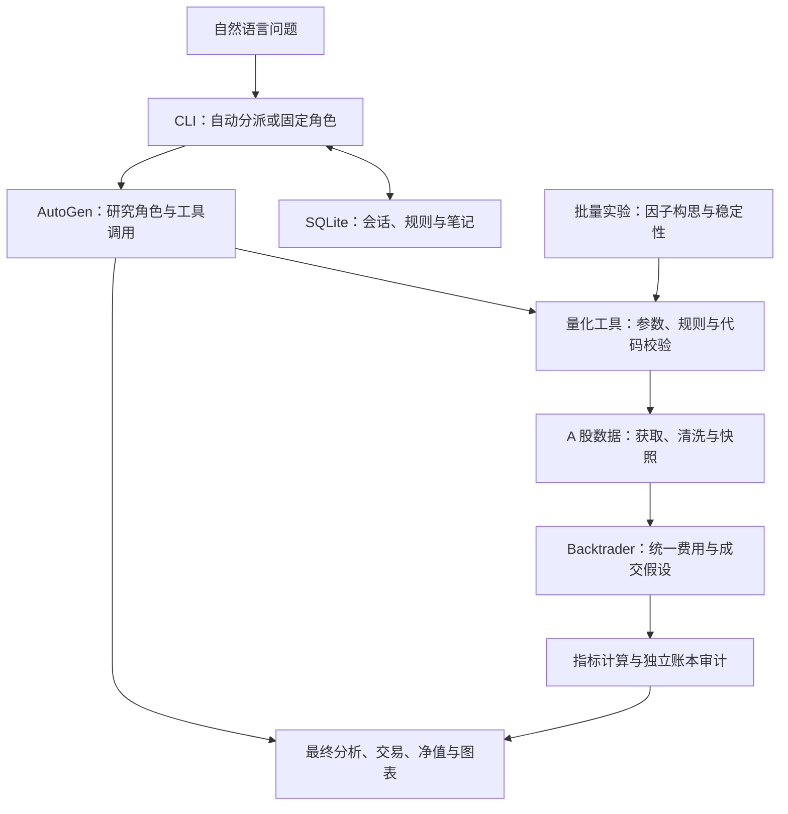

# FinRobot：A 股投研与量化实验

面向 MFM5110 小组项目的命令行研究工具：用自然语言提出股票与策略问题，由 Agent 调用数据、回测和风险工具，输出可核对的分析与实验记录。项目同时提供固定规则代码生成、受限因子构思、样本外评价和多案例稳定性实验。

**当前为最终版本（代码与实验交付），版本标识为 [V2](VERSION)。** 量化与 Memory 主流程已完成开发和验收；交付内容为代码、命令行入口、数据快照、实验结果与使用文档。课程报告正文尚未编写。现有实验未证明 LLM 能提高投资收益。

[实现与完成情况](#实现与完成情况) · [整体框架](#整体框架) · [安装与运行](#安装与运行) · [复现已有结果](#复现已有结果) · [实验结果与验收](#实验结果与验收) · [输出文件](#输出文件) · [使用边界](#使用边界) · [详细文档](#详细文档与来源)

已有项目环境和模型 Key 时，在仓库根目录启动：

```powershell
.\run_finrobot.cmd
```

## 实现与完成情况

| 模块 | 当前实现 | 完成与验证情况 |
| --- | --- | --- |
| A 股数据 | AkShare / Tushare 路由、行情回退、OHLCV 清洗、单位转换、快照及 SHA-256 校验 | 已完成量化流程所需数据处理，使用真实行情快照验证 |
| 参数化回测 | 按股票、日期、均线、资金和开仓预算运行 SMA，与买入持有比较 | 已完成；真实多轮交互、指标与独立交易账本核对通过 |
| LLM 代码生成 | 生成固定 SMA 的 Python 实现，检查语法、接口、规则、前缀因果性与引擎一致性，限时执行并保留修正记录 | 已完成；5 次独立生成最终通过，45 次冻结代码回放一致 |
| 因子计算与规则回测 | 确定性动量、波动率、成交量因子；聊天中提出并回测受限 JSON 规则 | 已完成；规则构思、跨轮回测与换股通过真实验证 |
| 表达式因子实验 | 根据构思期摘要提出受限表达式，冻结后在样本外评价 | 已完成；9 个去重因子、27 个样本外比较，未发现相对买入持有的收益优势 |
| 自动分派与汇总 | 按问题选择角色，多角色分别取证后汇总，分项失败明确标注 | 已完成；五轮真实交互通过，分项工具范围与规则续聊有回归检查 |
| 本地研究记忆 | SQLite 会话、完整 JSON 规则、显式笔记、历史检索与进程重启恢复 | 已完成；自动/单角色共 9 个真实场景通过，16 项回测数值核对一致 |
| 复现与交接 | 锁定依赖、根目录启动脚本、离线检查、指标汇总和排除私有数据的分享包 | 已完成；166 项单元测试与依赖检查通过，完整复验记录见下文 |
| 基本面、新闻与 PDF/RAG | 保留基本面、市场分析、研究报告及相关工具和示例 | 代码保留并做过部分修复；完整流程未逐项端到端验收 |

日常使用分为两条路径：**聊天入口**负责参数化回测、代码生成、因子计算、JSON 规则和续聊；**实验入口**负责固定样本的批量评价、表达式因子样本外回放及生成稳定性检查。

## 整体框架

项目采用 **Python + AutoGen Agent/工具调用 + Backtrader + SQLite**。模型负责解释、提出受限规则或代码；收益、风险和交易数字由 Python 工具计算。



自动分派使用规则匹配，不额外调用模型；多角色任务依次执行，再由综合角色汇总。Memory 使用本地 SQLite 与关键词检索，不增加额外 LLM/embedding 请求。上图展示量化主流程，基本面、新闻和报告角色另调用各自投研工具。

| 层次 | 主要文件 | 职责 |
| --- | --- | --- |
| 交互与分派 | [run_agent.py](finrobot_autogen/run_agent.py)、[research_router.py](finrobot_autogen/finrobot/agents/research_router.py) | 单次/多轮 CLI、角色选择、汇总、最终分析与日志 |
| 角色与提示词 | [agent_library.py](finrobot_autogen/finrobot/agents/agent_library.py)、[prompts.py](finrobot_autogen/finrobot/agents/prompts.py) | 角色职责、工具注册和生成约束 |
| 数据与交互实验 | [data_source/](finrobot_autogen/finrobot/data_source/)、[quant_dialogue.py](finrobot_autogen/finrobot/functional/quant_dialogue.py) | 数据适配、按参数隔离实验、对照及风险查询 |
| 规则与代码 | [momentum_backtest.py](finrobot_autogen/finrobot/functional/momentum_backtest.py)、[strategy_codegen.py](finrobot_autogen/finrobot/functional/strategy_codegen.py)、[factor_dsl.py](finrobot_autogen/finrobot/functional/factor_dsl.py) | JSON 规则、固定 SMA 代码及表达式 DSL 的校验与执行 |
| 回测与审计 | [quantitative.py](finrobot_autogen/finrobot/functional/quantitative.py) | 资金、费用、成交、绩效和独立账本核对 |
| 研究记忆 | [memory.py](finrobot_autogen/finrobot/agents/memory.py)、[memory_tools.py](finrobot_autogen/finrobot/agents/memory_tools.py) | 完整规则持久化、有界上下文与只读检索 |
| 批量实验与验证 | [experiments/](finrobot_autogen/experiments/)、[scripts/](scripts/)、[tests/](tests/) | 样本外实验、稳定性、离线复验与真实交互验收 |

## 安装与运行

以下命令均在**仓库根目录的 PowerShell** 中运行。已验证环境为 **Windows x64、Python 3.11.16、CPU**，无需独立显卡；依赖版本见 [Windows 锁定文件](requirements-windows-py311.lock.txt)。

### 1. 下载并进入项目

```powershell
git clone https://github.com/ohayoo335/Finrobot_MFM5110FinalProject_V2.git
cd Finrobot_MFM5110FinalProject_V2
```

也可在 [GitHub 仓库](https://github.com/ohayoo335/Finrobot_MFM5110FinalProject_V2) 选择 Code → Download ZIP。解压后，在同时包含 `README.md`、`setup.py` 和 `run_finrobot.cmd` 的目录打开 PowerShell。

### 2. 安装环境

先安装 Python 3.11，再依次执行：

```powershell
py -3.11 --version
py -3.11 -m venv .venv
.\.venv\Scripts\python.exe -m pip install -r requirements-windows-py311.lock.txt
.\.venv\Scripts\python.exe -m pip install --no-deps --no-build-isolation -e .
.\.venv\Scripts\python.exe -c "import nltk; nltk.download('punkt', download_dir='.cache/nltk_data'); nltk.download('averaged_perceptron_tagger', download_dir='.cache/nltk_data')"
.\.venv\Scripts\python.exe -m pip check
```

最后应显示 `No broken requirements found.`。安装依赖和 NLTK 数据需要联网，首次下载包含较大的 PDF/RAG 依赖。项目要求 Python 3.10–3.11，推荐上述已验证的 3.11；其他系统与可选 uv 安装见[使用说明](docs/USAGE.md#环境与常见问题)。

### 3. 先运行无需 Key 的复验

```powershell
.\.venv\Scripts\python.exe scripts/validate_v2.py
```

该命令使用仓库已有快照与模型输出，执行 9 项离线检查；控制台各项 `ok` 应为 `true`，结果写入 `artifacts/quant_v2/validation_summary.json`。它不重新发起模型对话。只想复现已有实验的组员可直接继续看[复现已有结果](#复现已有结果)。

### 4. 配置 Key 并开始对话

只在本地配置不存在时复制模板，不覆盖已有 Key：

```powershell
if (-not (Test-Path finrobot_autogen\OAI_CONFIG_LIST)) { Copy-Item finrobot_autogen\OAI_CONFIG_LIST.example.json finrobot_autogen\OAI_CONFIG_LIST }
if (-not (Test-Path finrobot_autogen\config_api_keys)) { Copy-Item finrobot_autogen\config_api_keys.example.json finrobot_autogen\config_api_keys }
```

| 文件 | 填写方式 |
| --- | --- |
| `finrobot_autogen/OAI_CONFIG_LIST` | 将 `api_key` 占位符替换为自己的 Key；模板默认 `deepseek-flash`，保留地址与 `extra_body.thinking.type=disabled` |
| `finrobot_autogen/config_api_keys` | 默认 `CN_DATA_PROVIDER=akshare`、`TUSHARE_TOKEN` 留空即可；需要 Tushare 时再按[使用说明](docs/USAGE.md#模型与数据配置)配置 |

两个实际配置文件都没有扩展名，内容为 JSON，已被 Git 忽略。然后启动：

```powershell
# 默认自动分派，进入多轮对话
.\run_finrobot.cmd
# 固定量化角色，适合先体验完整 SMA 流程
.\run_finrobot.cmd --role Quant_Analyst
```

在同一个 `Quant_Analyst` 会话中依次输入，每轮完成后再输入下一句：

```text
回测000651在2023-2024年的10/30均线，本金10万，开仓预算60%，比较买入持有并检查风险。
继续生成并运行同规则的Python代码，再检查生成策略的风险。
现在换成600031，2025年，20/60均线，开仓预算50%，重新比较并解释结果。
```

终端显示本轮最终分析与保存路径；先看 `.md`，再按 `experiment_id` 查指标、交易和图表。输入 `exit` 退出。真实模型请求会产生用量，框架显示的 `cost=0` 不代表免费，费用以服务商账单为准。

六个角色的选择、JSON 规则示例、会话恢复和笔记命令见[完整使用说明](docs/USAGE.md)。

## 复现已有结果

**推荐先运行上面的 `scripts/validate_v2.py`。** 它覆盖单元测试、依赖、交互工具、固定代码回放、多标的评价、稳定性代码重跑、因子回放和指标汇总。已有完整检查的本机耗时约 139 秒，不含首次安装；其他机器耗时会不同。

需要单独查看某一部分时，使用下表命令。均以仓库原始实验记录完整为前提，不需要模型 Key：

| 要复现什么 | 根目录命令 |
| --- | --- |
| 固定案例的 5 份代码执行与一致性 | `.\run_quant_v2.cmd verify` |
| 3 标的 × 3 时段的 45 次冻结代码回放 | `.\run_generalization.cmd evaluate --resume` |
| 15 次生成的稳定性统计 | `.\run_stability.cmd evaluate` |
| 在独立进程中重跑上述 15 份代码 | `.\run_stability.cmd verify` |
| 冻结因子的样本外评价 | `.\run_factor_ideation.cmd evaluate` |
| 首次成功率、修正率等指标汇总 | `.\.venv\Scripts\python.exe scripts/evaluate_agent_methodology.py` |
| 仅运行当前 166 项单元测试 | `.\.venv\Scripts\python.exe -m unittest discover -s tests -v` |

复现已有记录不等于重新生成模型回答。要进行新实验，需配置 Key、使用新的结果目录，并保留新请求与失败记录。具体实验配置、单项命令、新因子/稳定性实验和在线验收见[实验与复现说明](docs/EXPERIMENTS.md)。

## 实验结果与验收

| 任务 | 已保存的结果 | 证据入口 |
| --- | --- | --- |
| 固定 SMA 代码生成 | 5 次独立生成；首次 JSON 合格 80%，首次完整执行 60%，无需模型修正 80%，最终通过 100% | [生成评估](artifacts/quant_v2/evaluation.json)、[指标汇总](artifacts/quant_v2/methodology_metrics.md) |
| 多标的、多时段回放 | 3 个标的 × 3 个时段 × 5 份冻结代码，共 45 次回放，与人工同规则结果一致；未新增模型请求 | [多案例结果入口](artifacts/quant_generalization/latest.json) |
| 生成稳定性 | 3 组案例，每组 5 次独立生成，15/15 通过；规则、因果性及引擎一致性均通过 | [稳定性结果入口](artifacts/stability/latest.json) |
| 表达式因子样本外评价 | 3 次生成、12 个想法、去重后 9 个；27 个比较中，0 胜买入持有，12 胜 SMA | [因子结果入口](artifacts/factor_ideation/latest.json) |
| 量化真实交互 | 三轮参数化 SMA 流程通过；自动模式五轮流程通过，36 项数值检查一致 | [三轮量化验收](artifacts/quant_v2/dialogue_online_validation.json)、[自动模式验收](artifacts/quant_v2/auto_online_validation.json) |
| Memory 真实续聊 | 自动/单角色 9 个场景均在新 CLI 进程中执行，完整规则、换股、会话与笔记检查通过，16 项数值一致 | [Memory 验收](artifacts/quant_v2/memory_online_validation.json) |
| 离线与依赖 | 当前 166 项单元测试、依赖检查通过；完整 9 项复验的独立记录与执行范围见证据及实验说明 | [完整检查](artifacts/quant_v2/validation_summary.json)、[最新测试记录](artifacts/quant_v2/memory_online_validation.json) |

固定案例中，人工 SMA 与通过校验的 LLM SMA 收益完全一致，均为 −27.969558%；同预算买入持有为 −24.237415%。这证明了本案例的实现一致性，未证明模型能改善收益。因子样本外结果也未显示相对买入持有的优势。

首次成功与修正后成功分别统计；45 次冻结回放不是 45 次独立生成。Memory 验收有 1 个回答使用完整规则对象，未按要求外包 `rule_json`：规则内容完全一致，审计器兼容后端支持的两种形状，差异和原始失败审计均保留。具体口径见[实验说明](docs/EXPERIMENTS.md#结果与验收口径)。

## 输出文件

| 位置 | 内容 | 是否随仓库提供 |
| --- | --- | --- |
| `data/quant_v2/`、`data/quant_generalization/` | 已冻结的真实行情、配置、预热与清洗记录 | 是 |
| `artifacts/quant_v2/`、`artifacts/quant_generalization/` | 固定/多案例指标、生成代码、失败修正、交易、图表和脱敏验收摘要 | 是 |
| `artifacts/factor_ideation/`、`artifacts/stability/` | 因子与稳定性实验的请求、响应、代码、检查和对比结果 | 是 |
| `data/quant_dialogue/`、`artifacts/quant_dialogue/` | 个人交互实验的数据、参数、回测、代码与风险检查 | 否，Git 忽略 |
| `artifacts/agent_chats/`、`artifacts/quant_dialogue/chats/` | 个人最终分析 `.md`、完整历史 `.json`、过程 `.log` 和原始在线验收 | 否，Git 忽略 |
| `data/memory/research.sqlite3` | 本地会话、笔记、工具证据和完整 JSON 规则 | 否，数据库及 WAL/SHM 文件均排除 |

线上验收只公开脱敏摘要，下载仓库不能直接恢复作者的私有会话。分享包的文件与哈希见 [SHARE_MANIFEST.json](SHARE_MANIFEST.json)。

## 使用边界

- 聊天中的 Python 策略生成限于固定 SMA；JSON 规则与表达式因子只支持各自 DSL。未实现任意 Python 策略生成、自动参数搜索、自动择优、多资产组合策略或实盘下单。
- 回测为只做多的日线实验，信号最早下一交易日开盘执行。默认本金 10 万元、开仓预算 80%、100 股一手、佣金率 0.03%（最低 5 元）、滑点 0.05%；配置中的 `max_position` 是开仓预算，持仓权重会随价格漂移。
- 成交、费用和前复权均有简化，未完整模拟涨跌停、流动性、印花税、现金分红与公司行动；AST 校验和进程超时不等同于通用操作系统沙箱。
- 基本面、新闻、PDF/OCR、RAG 与保留的多 Agent 示例没有全部完成端到端验收。历史财务截止日做了过滤，但不能还原数据供应商的历史修订版本。
- Memory 是本地记录与检索，不训练模型，也不会自动进化策略；旧结论不能视为实时事实。`/forget` 只删除显式笔记，不抹除旧问答、日志或实验文件。
- 本版本交付命令行代码、实验材料和文档；网页界面、课程报告正文与文献综述不在当前已完成交付内。

## 详细文档与来源

- [使用说明](docs/USAGE.md)：角色、模型和数据配置、规则 DSL、Memory、工具及常见问题。
- [实验与复现](docs/EXPERIMENTS.md)：实验设计、指标口径、已有结果、新实验及真实在线验收。
- [PROJECT_STATUS.md](PROJECT_STATUS.md)：开发、修复、合并与验收的历史记录；首页以当前实现为准。
- [ENVIRONMENT_STATUS.md](ENVIRONMENT_STATUS.md)：本机依赖与兼容记录；[COMPLETION_PLAN.md](COMPLETION_PLAN.md) 保留原开发计划，不作为当前功能清单。

项目基于 [AI4Finance-Foundation/FinRobot](https://github.com/AI4Finance-Foundation/FinRobot) 与[组员共享项目](https://github.com/yjt2003/Finrobot_MFM5110FinalProject) 继续开发。课程项目版本标识为 `V2`，沿用的 Python 包版本为 `0.1.5`。许可与归属见 [LICENSE](LICENSE)、[NOTICE](NOTICE)、[TRADEMARK_POLICY.md](TRADEMARK_POLICY.md)。
